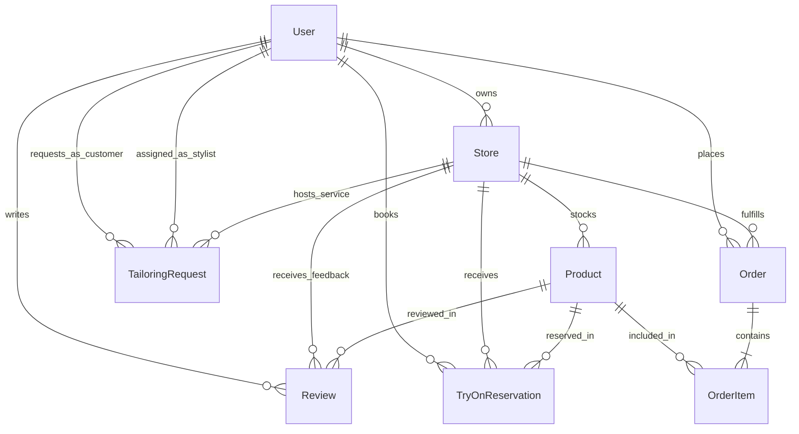

# NearWear Database ER Diagram

## Entity Relationship Overview

---

## Detailed Data Dictionary

### 1. `User`
| Field | Type | Attributes | Description |
| :--- | :--- | :--- | :--- |
| `id` | String | Primary Key (cuid) | Unique User ID |
| `email` | String | Unique, Indexed | User login email |
| `passwordHash` | String | Required | Bcrypt salted hash |
| `name` | String | Required | Full display name |
| `role` | String | Default: 'CUSTOMER' | Enum: CUSTOMER, STORE_OWNER, STYLIST, ADMIN |
| `phone` | String? | Optional | Contact phone number |
| `neighborhood` | String? | Optional | Preferred neighborhood (e.g. SoHo, Downtown) |
| `avatarUrl` | String? | Optional | Profile avatar image |
| `bio` | String? | Optional | Bio for stylists or shoppers |
| `createdAt` | DateTime | default(now()) | Timestamp of signup |
| `updatedAt` | DateTime | updated | Timestamp of last modification |

### 2. `Store`
| Field | Type | Attributes | Description |
| :--- | :--- | :--- | :--- |
| `id` | String | Primary Key (cuid) | Unique Store ID |
| `ownerId` | String | Foreign Key -> User.id | Store merchant user |
| `name` | String | Required | Boutique name |
| `slug` | String | Unique | URL slug (e.g. `velvet-thread-boutique`) |
| `description` | String | Required | Boutique summary and style identity |
| `category` | String | Required | Vintage, Streetwear, Designer, Tailoring, Casual |
| `address` | String | Required | Physical street address |
| `neighborhood` | String | Required, Indexed | Neighborhood area name |
| `city` | String | Required | City name |
| `postalCode` | String | Required | Postal / Zip code |
| `latitude` | Float | Required | Map latitude coordinate |
| `longitude` | Float | Required | Map longitude coordinate |
| `phone` | String | Required | Contact phone number |
| `email` | String | Required | Business email |
| `openingHours` | String | Required | e.g., "Mon-Sat: 10AM - 8PM, Sun: 11AM - 6PM" |
| `bannerUrl` | String | Required | Header cover photo |
| `logoUrl` | String | Required | Square brand logo |
| `isVerified` | Boolean | Default: false | Admin verification badge |
| `rating` | Float | Default: 5.0 | Average customer score |
| `createdAt` | DateTime | default(now()) | Store launch date |
| `updatedAt` | DateTime | updated | Update timestamp |

### 3. `Product`
| Field | Type | Attributes | Description |
| :--- | :--- | :--- | :--- |
| `id` | String | Primary Key (cuid) | Unique Product ID |
| `storeId` | String | Foreign Key -> Store.id | Parent store |
| `title` | String | Required | Product name |
| `description` | String | Required | Fabric composition, styling notes |
| `category` | String | Required | Outerwear, Tops, Bottoms, Dresses, Shoes, Accessories |
| `gender` | String | Default: 'UNISEX' | MEN, WOMEN, UNISEX, KIDS |
| `price` | Float | Required | Current selling price in USD |
| `compareAtPrice` | Float? | Optional | Original retail price for sales |
| `isAvailableForTryOn` | Boolean | Default: true | Can shopper reserve fitting room |
| `inStock` | Boolean | Default: true | Real-time in-store stock flag |
| `stockQuantity` | Int | Default: 5 | Total units on rack |
| `images` | String | Required (JSON Array) | Array of image URLs |
| `sizes` | String | Required (JSON Array) | e.g. ["XS", "S", "M", "L", "XL"] |
| `colors` | String | Required (JSON Array) | e.g. ["Navy", "Charcoal", "Cream"] |
| `tags` | String | Required (JSON Array) | e.g. ["sustainable", "linen", "summer"] |
| `createdAt` | DateTime | default(now()) | Added date |
| `updatedAt` | DateTime | updated | Last catalog update |

### 4. `TryOnReservation`
| Field | Type | Attributes | Description |
| :--- | :--- | :--- | :--- |
| `id` | String | Primary Key (cuid) | Reservation ticket ID |
| `customerId` | String | Foreign Key -> User.id | Shopper |
| `storeId` | String | Foreign Key -> Store.id | Target boutique |
| `productId` | String | Foreign Key -> Product.id | Reserved apparel item |
| `requestedDate` | String | Required | YYYY-MM-DD |
| `requestedTimeSlot` | String | Required | e.g. "14:00 - 14:30" |
| `selectedSize` | String | Required | Size requested on rack |
| `selectedColor` | String | Required | Color variant |
| `status` | String | Default: 'PENDING' | PENDING, CONFIRMED, COMPLETED, CANCELLED |
| `fittingRoomCode` | String? | Optional | e.g. "CABIN-2" |
| `notes` | String? | Optional | Customer fitting preferences |
| `createdAt` | DateTime | default(now()) | Booking time |
| `updatedAt` | DateTime | updated | Update timestamp |

### 5. `Order` & `OrderItem`
- `Order`: id, customerId, storeId, status (`PENDING`, `CONFIRMED`, `PREPARING`, `READY_FOR_PICKUP`, `DELIVERED`, `CANCELLED`), fulfillmentType (`IN_STORE_PICKUP`, `LOCAL_DELIVERY`), totalAmount, deliveryAddress, contactPhone, notes, createdAt, updatedAt
- `OrderItem`: id, orderId, productId, quantity, unitPrice, selectedSize, selectedColor

### 6. `TailoringRequest`
- id, customerId, storeId, stylistId, garmentDescription, serviceType (`HEM`, `ALTERATION`, `RESIZING`, `CUSTOM_FIT`, `STYLING_CONSULT`), status (`SUBMITTED`, `IN_REVIEW`, `ACCEPTED`, `IN_PROGRESS`, `READY`, `COMPLETED`), measurements (JSON string), estimatedPrice, targetCompletionDate, notes, createdAt, updatedAt

### 7. `Review`
- id, customerId, storeId, productId, rating (1 to 5), fitFeedback (`RUNS_SMALL`, `TRUE_TO_SIZE`, `RUNS_LARGE`), comment, createdAt
